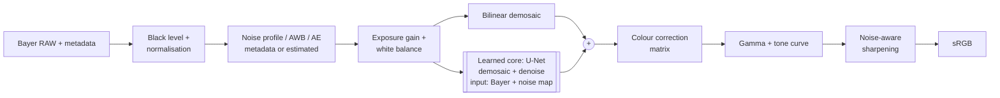
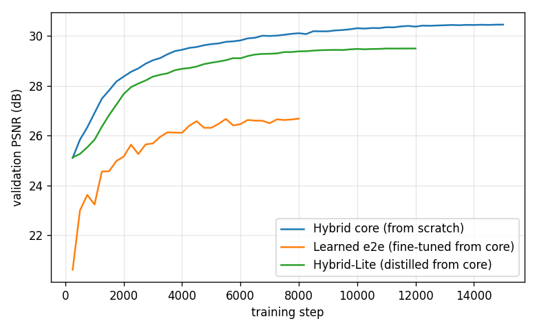
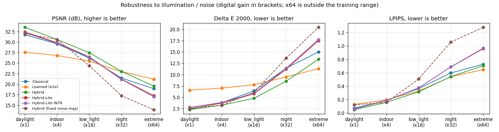
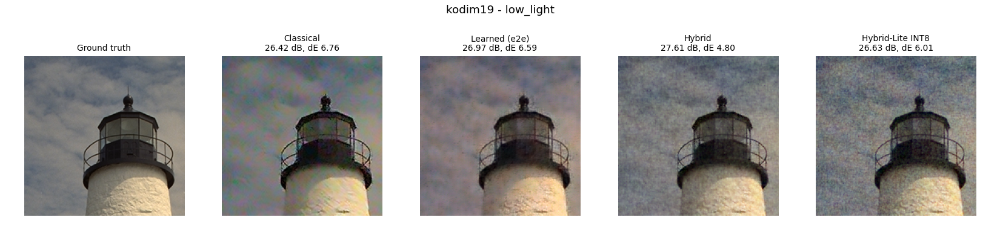
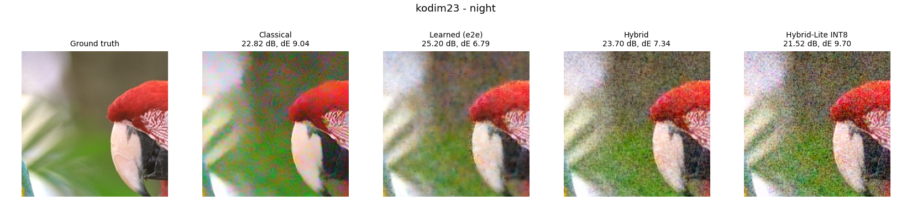
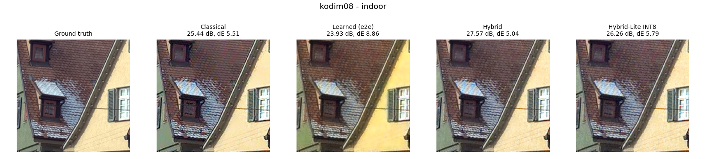
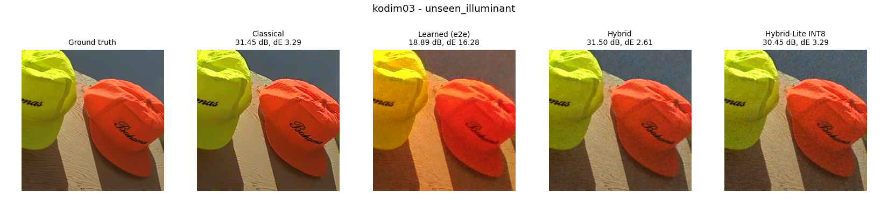
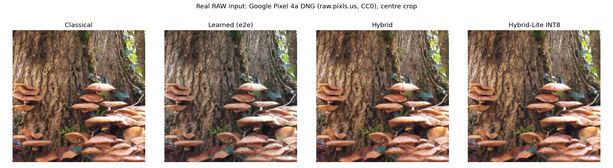

# Hybrid Smartphone ISP

CIE-3 project, Problem Statement P2: *Intelligent and Computationally Efficient Smartphone ISP*.

This repo implements three complete RAW-to-RGB pipelines and compares them:

1. **Classical ISP**: hand-tuned stages (black level, white balance, Malvar-He-Cutler demosaicing,
   colour correction, non-local means / bilateral denoising, gamma, tone curve, unsharp masking).
2. **Learned ISP (end-to-end)**: a compact U-Net that maps packed Bayer RAW directly to sRGB.
3. **Hybrid ISP (proposed)**: classical front end, a small learned core that does joint
   demosaicing + denoising conditioned on a noise map, and a classical colour/tone back end.
   A distilled and INT8-quantised version (Hybrid-Lite) is the deployable model.

The models were trained on a free Google Colab T4 GPU (`colab/hybrid_isp_colab.ipynb`, one click: Run all).
Inference, the demo app and all latency numbers are on a laptop CPU (Intel i5-10210U, 4 cores, no GPU).

## Results at a glance

Kodak24 test set, RAW simulated per scenario, every pipeline gets the same RAW and metadata.
PSNR (dB) / colour error (CIEDE2000). Latency: whole RAW-to-sRGB pipeline for a 1 MP frame on the laptop CPU.

| Pipeline | Daylight (x1) | Low light (x16) | Night (x32) | Unseen illuminant | Model size | Latency |
|---|---|---|---|---|---:|---:|
| Classical ISP | 31.73 / 2.41 | 26.20 / 6.44 | 21.44 / 11.44 | 29.60 / 3.82 | - | 1081 ms |
| Learned ISP (end-to-end) | 27.59 / 6.59 | 25.46 / 7.80 | 22.98 / 9.52 | 18.84 / 15.39 | 4.34 MB | 877 ms |
| **Hybrid ISP** | **33.49 / 2.28** | **27.47 / 4.80** | **23.02 / 8.58** | **30.53 / 3.29** | 4.34 MB | 1067 ms |
| Hybrid-Lite INT8 | 32.18 / 2.81 | 26.39 / 5.92 | 21.11 / 11.42 | 29.68 / 3.88 | **0.53 MB** | **657 ms** |

* The hybrid ISP is the best pipeline from daylight to night: +1.8 dB over the classical ISP in daylight,
  +1.3 dB in low light and +1.6 dB at night, with lower colour error and better LPIPS.
* Keeping colour science classical makes it robust: under an illuminant outside the training range the
  end-to-end network drops to 18.8 dB (it learned colour for the training illuminants only), the hybrid stays at 30.5 dB.
* Hybrid-Lite INT8 is 8x smaller than the full model, runs the whole pipeline 1.6x faster than the classical
  ISP, and still beats it in daylight, indoor and low light.
* Limits: at x64 gain (outside the training range) the learned models degrade, and without any metadata
  the learned white balance of the end-to-end model is slightly better than grey-world AWB. Details below.

## Pipeline design



Why this split:

* **Global, well-understood operations stay classical.** Black level, gain, white balance gains,
  CCM, gamma and tone curve are cheap, exact and come with calibration data. Keeping them out of the
  network means the network never has to learn colour science, so it cannot drift colours, and
  it does not need retraining for a new sensor (only the CCM changes).
* **The ill-posed local part is learned.** Demosaicing and denoising under heavy noise are where
  hand-made filters break down (zipper artifacts, false colour on fine texture, smeared detail).
  The network does both jointly on the packed Bayer planes, *before* the CCM, while the noise
  is still independent per pixel and follows a known model.
* **Processing order.** White balance and gain are applied before the network, so its input
  always looks the same (neutral, normalised brightness) whatever the illuminant or light level.
  This is what makes a small model enough. The network predicts a residual on top of a
  bilinear demosaic, which makes training converge much faster.
* **Trained through the classical stages.** The loss is computed on the final sRGB output,
  after the (differentiable) CCM, gamma and tone curve, so the core is optimised for what the
  user actually sees and not for linear-space error.

### Adaptive processing

The pipeline adapts to every frame instead of using fixed parameters:

| Quantity | From metadata | Fallback (estimated from the RAW itself) | Used for |
|---|---|---|---|
| Noise profile (shot, read) | sensor calibration (like the DNG NoiseProfile tag) | blind estimator: high-pass on each Bayer plane, flattest 8x8 blocks per brightness bin, non-negative fit of `var = shot*x + read` | per-pixel noise map fed to the network, NLM/bilateral strength, sharpening amount |
| Exposure gain | capture settings | auto exposure (mean green to 18% grey) | brightness normalisation, scales the noise map |
| White balance | as-shot gains | grey-world AWB, clamped to the illuminant range the sensor is calibrated for | WB stage |

The blind noise estimator was checked on all 24 test images: the median estimate is within 12% of
the true noise level from indoor light down to x64 gain (1.12x, 1.05x, 1.02x, 1.00x). In bright daylight
it over-estimates (median 1.47x) because the noise is tiny and fine texture leaks into the high-pass;
that only makes the denoising slightly stronger.

## Data

Public paired RAW/RGB datasets (ZRR, SIDD) are tens of GB, so RAW is synthesised from clean sRGB images with the
"unprocessing" model of Brooks et al. (CVPR 2019), which is invertible, so the original image is
the exact ground truth:

`sRGB -> inverse tone curve -> inverse gamma -> sRGB->camera matrix -> inverse WB ->
RGGB mosaic -> under-exposure (1/gain) -> shot + read noise -> 10-bit quantisation with black level`

* Training: DIV2K validation set (100 images, downscaled x2), last 5 held out for validation.
  Every batch gets a random illuminant (R gain 1.6-2.6, B gain 1.3-2.1), light level (gain 1-32)
  and sensor noise (shot 1e-4 to 1e-3, read noise from the log-linear fit of Brooks et al.).
* Test: Kodak24, never used for training. Parameters (classical denoise strength, AWB variant) were chosen
  on DIV2K; the one change made after looking at test results is described in the development note below.
* Real RAW: a Google Pixel 4a DNG from raw.pixls.us (CC0) is used to show the pipeline on real
  sensor data (no ground truth).

Test scenarios (each Kodak image keeps the same illuminant across scenarios):

| Scenario | Gain | Shot noise | Notes |
|---|---|---|---|
| daylight | x1 | 2e-4 | |
| indoor | x4 | 5e-4 | |
| low_light | x16 | 5e-4 | |
| night | x32 | 1e-3 | edge of training range |
| extreme | x64 | 1e-3 | **outside** training range |
| unseen_illuminant | x4 | 5e-4 | WB gains R 1.3 / B 2.6, outside training range |
| no_metadata | x4 | 5e-4 | WB and noise profile removed, both estimated |

## Models and training

`model.py`: U-Net on packed Bayer (H/2 x W/2), input 4 RAW planes + 4 noise-std planes,
three down/up-sampling levels, a global-average-pooling branch at the bottleneck (scene-level
context for colour and brightness), and pixel-shuffle output to full resolution.

| Model | Width | Params | Training |
|---|---|---|---|
| Hybrid core | 24 | 1.13 M | from scratch, 15k steps, loss on the final sRGB output |
| Learned ISP (e2e) | 24 | 1.13 M | **fine-tuned from the hybrid core weights** (8k steps): same network adapted to also learn WB, colour correction and tone |
| Hybrid-Lite | 16 | 0.50 M | **knowledge distillation** from the hybrid core (12k steps), loss = 0.5 L1(GT) + 0.5 L1(teacher) |
| Hybrid-Lite INT8 | 16 | 0.50 M | **post-training static INT8 quantisation** (FX graph mode, oneDNN), calibrated on 64 training crops; first conv and output head kept in FP32 |

Batch 32, 128x128 crops, Adam (3e-4, cosine decay), L1 loss, about 25 min in total on a T4.
Validation PSNR during training:



## Results

### Image quality

Averages over the 24 Kodak images per scenario. PSNR/SSIM on sRGB, colour error = mean CIEDE2000,
LPIPS with AlexNet features. Best value per column in bold (the ablation row is not ranked).
Generated by `python evaluate.py` (`results/metrics.md`).

**PSNR (dB) &uarr;**

| Method | daylight | indoor | low_light | night | extreme | unseen_illuminant | no_metadata |
|---|---:|---:|---:|---:|---:|---:|---:|
| Classical | 31.73 | 29.56 | 26.20 | 21.44 | 18.95 | 29.60 | 25.97 |
| Learned (e2e) | 27.59 | 26.81 | 25.46 | 22.98 | **21.21** | 18.84 | **26.70** |
| Hybrid | **33.49** | **30.60** | **27.47** | **23.02** | 19.55 | **30.53** | 26.17 |
| Hybrid-Lite | 32.39 | 29.85 | 26.47 | 21.18 | 17.28 | 29.80 | 25.95 |
| Hybrid-Lite INT8 | 32.18 | 29.72 | 26.39 | 21.11 | 17.03 | 29.68 | 25.75 |
| Hybrid (fixed noise map) | 31.99 | 30.60 | 24.37 | 17.25 | 13.94 | - | - |

**SSIM &uarr;**

| Method | daylight | indoor | low_light | night | extreme | unseen_illuminant | no_metadata |
|---|---:|---:|---:|---:|---:|---:|---:|
| Classical | 0.937 | 0.856 | 0.705 | 0.460 | 0.328 | 0.858 | 0.833 |
| Learned (e2e) | 0.919 | 0.854 | **0.742** | **0.543** | **0.419** | 0.804 | 0.841 |
| Hybrid | **0.951** | **0.865** | 0.723 | 0.477 | 0.312 | **0.864** | **0.846** |
| Hybrid-Lite | 0.942 | 0.836 | 0.662 | 0.397 | 0.241 | 0.834 | 0.825 |
| Hybrid-Lite INT8 | 0.935 | 0.831 | 0.658 | 0.390 | 0.227 | 0.828 | 0.820 |
| Hybrid (fixed noise map) | 0.912 | 0.865 | 0.549 | 0.262 | 0.161 | - | - |

**Colour error &Delta;E2000 &darr;**

| Method | daylight | indoor | low_light | night | extreme | unseen_illuminant | no_metadata |
|---|---:|---:|---:|---:|---:|---:|---:|
| Classical | 2.41 | 3.84 | 6.44 | 11.44 | 15.03 | 3.82 | 7.83 |
| Learned (e2e) | 6.59 | 7.04 | 7.80 | 9.52 | **11.33** | 15.39 | **7.17** |
| Hybrid | **2.28** | **3.28** | **4.80** | **8.58** | 13.42 | **3.29** | 7.70 |
| Hybrid-Lite | 2.55 | 3.72 | 5.80 | 11.24 | 17.51 | 3.72 | 7.85 |
| Hybrid-Lite INT8 | 2.81 | 3.89 | 5.92 | 11.42 | 17.77 | 3.88 | 8.08 |
| Hybrid (fixed noise map) | 2.61 | 3.28 | 6.09 | 13.66 | 20.45 | - | - |

**LPIPS &darr;**

| Method | daylight | indoor | low_light | night | extreme | unseen_illuminant | no_metadata |
|---|---:|---:|---:|---:|---:|---:|---:|
| Classical | 0.074 | 0.189 | 0.364 | 0.598 | 0.727 | 0.190 | 0.258 |
| Learned (e2e) | 0.129 | 0.198 | 0.328 | **0.540** | **0.648** | 0.327 | 0.218 |
| Hybrid | **0.050** | **0.159** | **0.317** | 0.543 | 0.706 | **0.158** | **0.217** |
| Hybrid-Lite | 0.061 | 0.186 | 0.375 | 0.687 | 0.958 | 0.186 | 0.230 |
| Hybrid-Lite INT8 | 0.063 | 0.188 | 0.375 | 0.689 | 0.965 | 0.187 | 0.233 |
| Hybrid (fixed noise map) | 0.123 | 0.159 | 0.509 | 1.056 | 1.276 | - | - |



| | |
|---|---|
|  |  |
|  |  |

What the numbers show:

1. **Hybrid vs classical.** Both share the same colour correction, gamma and tone curve; the learned core
   only replaces Malvar-He-Cutler demosaicing + NLM/bilateral denoising. It removes the false-colour demosaicing
   artifacts on fine texture (roof tiles in the kodim08 crop: 25.4 -> 27.6 dB) and, in low light, denoises
   without the blotchy chroma noise the classical chroma filter leaves behind. Colour error drops as well (low light: 6.44 -> 4.80).
2. **Hybrid vs end-to-end.** Same network, same data, same inputs; the only difference is which stages are
   learned. Having to learn white balance, CCM and tone costs the end-to-end model 2-6 dB and two to three
   times the colour error in normal light, and it breaks completely for an unseen illuminant (ΔE 15.4). Its colour errors are visible as casts,
   e.g. the over-yellow wall in kodim08.
   Its learned AWB is the better choice when there is no white balance metadata at all, and it degrades
   more gracefully at extreme noise.
3. **Adaptive processing (ablation).** "Hybrid (fixed noise map)" is the same network always given the
   noise map of the indoor level. It is identical at indoor light by construction, but loses 3.1 dB in low light
   and 5.8 dB at night. Telling the network how noisy each frame is (from metadata or the blind estimator) is
   what lets one model cover x1 to x32 gain.
4. **Degradation.** Every pipeline loses quality as light drops (plot above). Inside the training range the
   hybrid stays on top; at x64 it falls to 19.6 dB, only 0.6 dB above the classical ISP and below the end-to-end
   model, and the distilled Lite model degrades the most. Covering this would need training data at those gains.
   The noise estimator itself is still accurate there (1.00x).
5. **No metadata.** With the as-shot white balance and noise profile removed, everything is estimated from
   the image. Grey-world AWB clamped to the calibrated illuminant range of the sensor keeps the classical and
   hybrid pipelines at about 26 dB.

#### Development note: first training run

The first Colab run trained the core with small random white balance errors on its input (5% jitter), so that
it would tolerate imperfect AWB, and used shades-of-grey (p = 4) AWB without a range constraint. The evaluation
showed two problems:

* With correct white balance the network still "corrected" colours towards the training set statistics,
  adding a constant tint (mean a* +1.8, b* -1.2 in Lab). Daylight ΔE was 3.09, worse than the classical ISP (2.41).
* Without metadata, the unconstrained AWB made large errors (classical 21.6 dB, hybrid 22.1 dB).

The jitter was removed, the AWB changed to grey-world clamped to the calibrated illuminant range (p chosen on
DIV2K, not on the test set), the Lite model widened from 12 to 16 channels, and everything retrained (run 2,
the numbers above). Daylight ΔE went from 3.09 to 2.28 and the no-metadata scenario from 22.1 to 26.2 dB.

### Efficiency

Laptop CPU (Intel i5-10210U, 4 threads), 1024 x 1024 output frame. Generated by `python benchmark.py`
(`results/efficiency.md`).

| Model | Params (M) | Size (MB) | Feature maps / frame (MB) | Latency (ms) |
|---|---:|---:|---:|---:|
| Learned e2e (FP32) | 1.134 | 4.34 | 293 | 846 |
| Hybrid core (FP32) | 1.134 | 4.34 | 293 | 835 |
| Hybrid core (INT8) | 1.134 | 1.14 | 163 | 670 |
| Hybrid-Lite, distilled (FP32) | 0.505 | 1.94 | 203 | 413 |
| Hybrid-Lite, distilled (INT8) | 0.505 | 0.53 | 114 | 447 |

| Full pipeline (RAW in, sRGB out) | Latency (ms) |
|---|---:|
| Classical ISP | 1081 |
| Learned ISP (e2e) | 877 |
| Hybrid ISP | 1067 |
| Hybrid-Lite ISP (FP32) | 658 |
| Hybrid-Lite ISP (INT8) | 657 |

* **Knowledge distillation:** 2.2x fewer parameters and 2x faster than the full core, about 1 dB lower PSNR,
  still ahead of the classical ISP in normal and low light.
* **INT8 quantisation:** 3.7-3.8x smaller model files and 44% less feature-map memory, for at most 0.25 dB PSNR.
  The core gets 1.25x faster. The Lite model does not get faster on this CPU: it has AVX2 but no VNNI int8
  dot-product instructions, and narrow layers are memory bound. On a phone NPU/DSP INT8 is the native fast path,
  so on a real device the size and memory savings come with a speed-up.
* **Full pipelines** include the classical stages (NumPy/OpenCV). The classical ISP is the slowest because
  non-local means is expensive; Hybrid-Lite INT8 converts a 1 MP RAW frame to sRGB in 657 ms.
* "Feature maps / frame" is the total size of all layer outputs for one frame, an upper bound on activation memory.

### Real RAW input



A real 12 MP Google Pixel 4a DNG (centre crop shown, no ground truth). The classical and hybrid pipelines use
the as-shot white balance and colour matrix stored in the DNG, so colours come out right even though the
network never saw this sensor: it only does demosaicing and denoising, which do not depend on the colour
response of the sensor. Exposure gain and the noise profile are estimated from the RAW. The end-to-end model
learned the colour response of the simulated training sensor, so on the real sensor its output is softer and
greyer. This is the main practical argument for the hybrid split.

### Limitations

* The RAW is synthesised, so real-sensor effects (fixed-pattern noise, lens shading, optical blur) are not
  in the training data. Fine-tuning the core on a real paired dataset such as ZRR would be the next step.
* x64 gain is outside the training range and all learned models degrade there.
* Without metadata the AWB is still grey-world; a small learned illuminant estimator would close the gap.
* Latency is measured with PyTorch on a laptop CPU, not on a phone NPU.

## Requirement checklist

| Problem statement item | Where |
|---|---|
| Bayer RAW preprocessing, demosaicing | `classical_isp.py`: `normalize`, `demosaic_mhc`; `hybrid_isp.load_raw` for real files |
| White balance, CCM | `apply_wb`, `gray_world` (AWB), `apply_ccm`; CCM from sensor calibration / DNG |
| Denoising, edge-preserving filtering | `denoise`: non-local means on luma, bilateral on chroma, strength from the noise profile |
| Gamma, tone mapping | `gamma`, `tone_map` (and their differentiable versions in `raw_sim.py`) |
| Sharpening, colour-space transforms | `sharpen` (unsharp mask on luma), RGB/YCbCr, Lab for ΔE |
| Learned ISP architecture | `model.py` (U-Net with noise map and global context) |
| Model adaptation / fine-tuning | end-to-end ISP fine-tuned from the core weights (`train.py e2e --init`) |
| Restoration + colour transformation learned | core: demosaic + denoise; end-to-end: also WB, CCM and tone |
| Robustness to noise and illumination | training over x1-x32 gain and a range of illuminants; 7 test scenarios |
| Hybrid ISP, optimised order | `hybrid_isp.HybridISP`, design section above |
| Comparison classical / learned / hybrid | `evaluate.py`, tables and figures above |
| Adaptive pipeline | noise map conditioning, blind noise estimation, AE/AWB fallbacks, noise-aware denoise/sharpen, ablation |
| RAW-to-RGB on Bayer input | simulated RGGB 10-bit RAW + real Pixel 4a DNG |
| Optimisation | knowledge distillation (Hybrid-Lite) + INT8 post-training quantisation |
| Model size, memory, latency | `benchmark.py`, efficiency table |
| Degradation / recovery | robustness plot, x64 scenario, unseen illuminant, no-metadata scenario, development note |
| Metrics | PSNR, SSIM, ΔE (CIEDE2000), LPIPS, parameters, size, latency, memory |

## How to run

```bash
pip install -r requirements.txt
python prepare_data.py                 # Kodak24 + DIV2K (~120 MB after resizing)

# training (GPU recommended; on Colab just open colab/hybrid_isp_colab.ipynb and Run all)
python train.py core --width 24 --steps 15000 --batch 32
python train.py e2e  --width 24 --steps 8000  --batch 32 --init checkpoints/core.pt
python train.py lite --width 16 --steps 12000 --batch 32 --teacher checkpoints/core.pt

python benchmark.py                    # INT8 model + size / memory / latency -> results/efficiency.md
python evaluate.py                     # quality comparison + figures       -> results/

streamlit run app.py                   # interactive demo (simulated captures or upload a DNG)
python hybrid_isp.py photo.dng -o out.png   # process a real RAW file (--crop 2048 on low-RAM machines)
```

Trained checkpoints are included in `checkpoints/`, so training can be skipped.

## Files

| File | Contents |
|---|---|
| `raw_sim.py` | sensor model, RAW synthesis, shared colour/tone ops, test conditions |
| `classical_isp.py` | all classical stages, noise estimation, AWB, the classical baseline pipeline |
| `model.py` | U-Net |
| `hybrid_isp.py` | hybrid and end-to-end pipelines, INT8 quantisation, real RAW loader, CLI |
| `train.py` | training (core / e2e fine-tuning / distillation) |
| `metrics.py` | PSNR, SSIM, CIEDE2000, LPIPS |
| `evaluate.py` | quality comparison over all scenarios, figures |
| `benchmark.py` | parameters, size, memory, latency, INT8 export |
| `app.py` | Streamlit demo |
| `test_isp.py` | sanity checks for the building blocks (`python test_isp.py`) |
| `colab/` | self-contained Colab notebook used for training + the script that builds it |

## References

* T. Brooks et al., *Unprocessing Images for Learned Raw Denoising*, CVPR 2019.
* A. Ignatov, L. Van Gool, R. Timofte, *Replacing Mobile Camera ISP with a Single Deep Learning Model* (PyNET), CVPRW 2020.
* O. Ronneberger, P. Fischer, T. Brox, *U-Net*, MICCAI 2015.
* H. Malvar, L. He, R. Cutler, *High-quality linear interpolation for demosaicing of Bayer-patterned color images*, ICASSP 2004.
* K. Zhang, W. Zuo, L. Zhang, *FFDNet: Toward a Fast and Flexible Solution for CNN based Image Denoising*, TIP 2018.
* J. Immerkaer, *Fast Noise Variance Estimation*, CVIU 1996.
* G. Hinton, O. Vinyals, J. Dean, *Distilling the Knowledge in a Neural Network*, 2015.
* R. Zhang et al., *The Unreasonable Effectiveness of Deep Features as a Perceptual Metric* (LPIPS), CVPR 2018.
