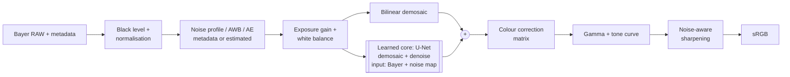

# Hybrid Smartphone ISP

CIE-3 project, Problem Statement P2: *Intelligent and Computationally Efficient Smartphone ISP*.

This repo implements three complete RAW-to-RGB pipelines and compares them:

1. **Classical ISP**: hand-tuned stages (black level, white balance, Malvar-He-Cutler demosaicing,
   colour correction, non-local means / bilateral denoising, gamma, tone curve, unsharp masking).
2. **Learned ISP (end-to-end)**: a compact U-Net that maps packed Bayer RAW directly to sRGB.
3. **Hybrid ISP (proposed)**: classical front end, a small learned core that does joint
   demosaicing + denoising conditioned on a noise map, and a classical colour/tone back end.
   A distilled and INT8-quantised version (Hybrid-Lite) is the deployable model.

The models were trained on a free Google Colab T4 GPU (`colab/hybrid_isp_colab.ipynb`, one click: Run all).
Inference, the demo app and all latency numbers are on a laptop CPU (Intel i5-10210U, 4 cores, no GPU).

## Pipeline design



Why this split:

* **Global, well-understood operations stay classical.** Black level, gain, white balance gains,
  CCM, gamma and tone curve are cheap, exact and come with calibration data. Keeping them out of the
  network means the network never has to learn colour science, so it cannot drift colours, and
  it does not need retraining for a new sensor (only the CCM changes).
* **The ill-posed local part is learned.** Demosaicing and denoising under heavy noise are where
  hand-made filters break down (zipper artifacts, false colour on fine texture, smeared detail).
  The network does both jointly on the packed Bayer planes, *before* the CCM, while the noise
  is still independent per pixel and follows a known model.
* **Processing order.** White balance and gain are applied before the network, so its input
  always looks the same (neutral, normalised brightness) whatever the illuminant or light level.
  This is what makes a small model enough. The network predicts a residual on top of a
  bilinear demosaic, which makes training converge much faster.
* **Trained through the classical stages.** The loss is computed on the final sRGB output,
  after the (differentiable) CCM, gamma and tone curve, so the core is optimised for what the
  user actually sees and not for linear-space error.

### Adaptive processing

The pipeline adapts to every frame instead of using fixed parameters:

| Quantity | From metadata | Fallback (estimated from the RAW itself) | Used for |
|---|---|---|---|
| Noise profile (shot, read) | sensor calibration (like the DNG NoiseProfile tag) | blind estimator: high-pass on each Bayer plane, flattest 8x8 blocks per brightness bin, non-negative fit of `var = shot*x + read` | per-pixel noise map fed to the network, NLM/bilateral strength, sharpening amount |
| Exposure gain | capture settings | auto exposure (mean green to 18% grey) | brightness normalisation, scales the noise map |
| White balance | as-shot gains | grey-world AWB, clamped to the illuminant range the sensor is calibrated for | WB stage |

The blind noise estimator was checked on all 24 test images: the median estimate is within 12% of
the true noise level from indoor light down to x64 gain (1.12x, 1.05x, 1.02x, 1.00x). In bright daylight
it over-estimates (median 1.47x) because the noise is tiny and fine texture leaks into the high-pass;
that only makes the denoising slightly stronger.

## Data

Public paired RAW/RGB datasets (ZRR, SIDD) are tens of GB, so RAW is synthesised from clean sRGB images with the
"unprocessing" model of Brooks et al. (CVPR 2019), which is invertible, so the original image is
the exact ground truth:

`sRGB -> inverse tone curve -> inverse gamma -> sRGB->camera matrix -> inverse WB ->
RGGB mosaic -> under-exposure (1/gain) -> shot + read noise -> 10-bit quantisation with black level`

* Training: DIV2K validation set (100 images, downscaled x2), last 5 held out for validation.
  Every batch gets a random illuminant (R gain 1.6-2.6, B gain 1.3-2.1), light level (gain 1-32)
  and sensor noise (shot 1e-4 to 1e-3, read noise from the log-linear fit of Brooks et al.).
* Test: Kodak24, never used for training or tuning.
* Real RAW: a Google Pixel 4a DNG from raw.pixls.us (CC0) is used to show the pipeline on real
  sensor data (no ground truth).

Test scenarios (each Kodak image keeps the same illuminant across scenarios):

| Scenario | Gain | Shot noise | Notes |
|---|---|---|---|
| daylight | x1 | 2e-4 | |
| indoor | x4 | 5e-4 | |
| low_light | x16 | 5e-4 | |
| night | x32 | 1e-3 | edge of training range |
| extreme | x64 | 1e-3 | **outside** training range |
| unseen_illuminant | x4 | 5e-4 | WB gains R 1.3 / B 2.6, outside training range |
| no_metadata | x4 | 5e-4 | WB and noise profile removed, both estimated |

## Models and training

`model.py`: U-Net on packed Bayer (H/2 x W/2), input 4 RAW planes + 4 noise-std planes,
three down/up-sampling levels, a global-average-pooling branch at the bottleneck (scene-level
context for colour and brightness), and pixel-shuffle output to full resolution.

| Model | Width | Params | Training |
|---|---|---|---|
| Hybrid core | 24 | 1.13 M | from scratch, 15k steps, loss on the final sRGB output |
| Learned ISP (e2e) | 24 | 1.13 M | **fine-tuned from the hybrid core weights** (8k steps): same network adapted to also learn WB, colour correction and tone |
| Hybrid-Lite | 16 | 0.51 M | **knowledge distillation** from the hybrid core (12k steps), loss = 0.5 L1(GT) + 0.5 L1(teacher) |
| Hybrid-Lite INT8 | 16 | 0.51 M | **post-training static INT8 quantisation** (FX graph mode, oneDNN), calibrated on 64 training crops; first conv and output head kept in FP32 |

Batch 32, 128x128 crops, Adam (3e-4, cosine decay), L1 loss, about 25 min in total on a T4.
Training curves: `results/training.png`.

## How to run

```bash
pip install -r requirements.txt
python prepare_data.py                 # Kodak24 + DIV2K (~120 MB after resizing)

# training (GPU recommended; on Colab just open colab/hybrid_isp_colab.ipynb and Run all)
python train.py core --width 24 --steps 15000 --batch 32
python train.py e2e  --width 24 --steps 8000  --batch 32 --init checkpoints/core.pt
python train.py lite --width 16 --steps 12000 --batch 32 --teacher checkpoints/core.pt

python benchmark.py                    # INT8 model + size / memory / latency -> results/efficiency.md
python evaluate.py                     # quality comparison + figures       -> results/

streamlit run app.py                   # interactive demo (simulated captures or upload a DNG)
python hybrid_isp.py photo.dng -o out.png   # process a real RAW file
```

Trained checkpoints are included in `checkpoints/`, so training can be skipped.

## Files

| File | Contents |
|---|---|
| `raw_sim.py` | sensor model, RAW synthesis, shared colour/tone ops, test conditions |
| `classical_isp.py` | all classical stages, noise estimation, AWB, the classical baseline pipeline |
| `model.py` | U-Net |
| `hybrid_isp.py` | hybrid and end-to-end pipelines, INT8 quantisation, real RAW loader, CLI |
| `train.py` | training (core / e2e fine-tuning / distillation) |
| `metrics.py` | PSNR, SSIM, CIEDE2000, LPIPS |
| `evaluate.py` | quality comparison over all scenarios, figures |
| `benchmark.py` | parameters, size, memory, latency, INT8 export |
| `app.py` | Streamlit demo |
| `test_isp.py` | sanity checks for the building blocks (`python test_isp.py`) |
| `colab/` | self-contained Colab notebook used for training + the script that builds it |

## References

* T. Brooks et al., *Unprocessing Images for Learned Raw Denoising*, CVPR 2019.
* A. Ignatov, L. Van Gool, R. Timofte, *Replacing Mobile Camera ISP with a Single Deep Learning Model* (PyNET), CVPRW 2020.
* O. Ronneberger, P. Fischer, T. Brox, *U-Net*, MICCAI 2015.
* H. Malvar, L. He, R. Cutler, *High-quality linear interpolation for demosaicing of Bayer-patterned color images*, ICASSP 2004.
* K. Zhang, W. Zuo, L. Zhang, *FFDNet: Toward a Fast and Flexible Solution for CNN based Image Denoising*, TIP 2018.
* J. Immerkaer, *Fast Noise Variance Estimation*, CVIU 1996.
* G. Hinton, O. Vinyals, J. Dean, *Distilling the Knowledge in a Neural Network*, 2015.
* R. Zhang et al., *The Unreasonable Effectiveness of Deep Features as a Perceptual Metric* (LPIPS), CVPR 2018.
