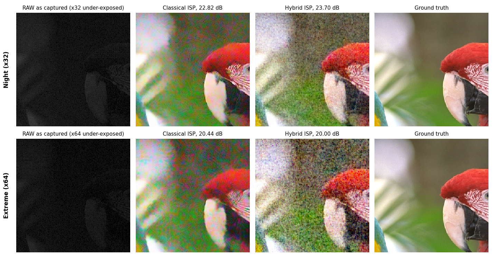
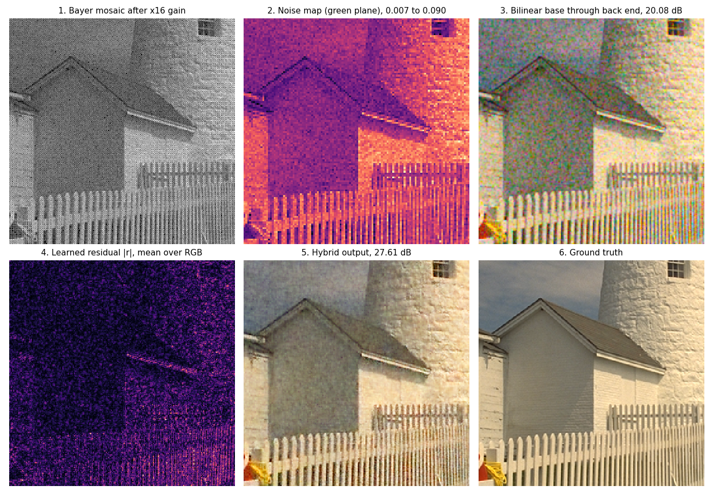

# Ablation study and failure-case analysis

Team T67 (Kuck coders), problem P2. All quality numbers come from the Kodak24 test captures (24 images per scenario,
the same captures for every variant) in `results/metrics.json`, except the rows marked "run 1", which come from
our first full training run.

## Ablation study

### 1. Adaptive noise map vs. a fixed one

Same trained hybrid core; the only change is that the network always receives the noise map of the indoor
level (x4), whatever the real light level is.

| Light level | PSNR, adaptive map (dB) | PSNR, fixed map (dB) | Change (dB) | LPIPS, adaptive | LPIPS, fixed |
|---|---:|---:|---:|---:|---:|
| Daylight (x1) | 33.49 | 31.99 | -1.50 | 0.050 | 0.123 |
| Indoor (x4) | 30.60 | 30.60 | 0.00 | 0.159 | 0.159 |
| Low light (x16) | 27.47 | 24.37 | -3.10 | 0.317 | 0.509 |
| Night (x32) | 23.02 | 17.25 | -5.77 | 0.543 | 1.056 |
| Extreme (x64) | 19.55 | 13.94 | -5.61 | 0.706 | 1.276 |

At indoor light the fixed map equals the real one, so nothing changes. In daylight the fixed map overstates the
noise and the network smooths away detail; in dim light it understates the noise and the noise passes through.
The per-frame noise map is what lets one network cover x1 to x32.

### 2. Classical colour stages vs. learned colour

The end-to-end model is the same U-Net, trained on the same data and initialised from the hybrid core. The
only difference is that it receives the RAW without white balance and must learn white balance, colour matrix
and tone curve itself.

| Measured on | Hybrid (classical colour) | End-to-end (learned colour) |
|---|---:|---:|
| Mean PSNR, all 168 captures | 27.26 dB | 24.23 dB |
| Mean colour error (Delta E 2000), all captures | 6.19 | 9.26 |
| Unseen illuminant, PSNR | 30.53 dB | 18.84 dB |
| Unseen illuminant, Delta E 2000 | 3.29 | 15.39 |
| No metadata, PSNR | 26.17 dB | 26.70 dB |
| Extreme (x64), PSNR | 19.55 dB | 21.21 dB |

Learning colour costs 3 dB on average and fails for light outside the training range. The end-to-end model
does better in two cases: with no white-balance metadata, where its learned white balance beats grey world,
and at x64, where it smooths more.

### 3. Training choices (run 1 vs. run 2)

Run 1 differed from the final run in three ways: 5% random white-balance jitter on the core's input during
training, shades-of-grey AWB with p = 4 and no range clamp, and a width-12 Lite model.

| Measured on | Run 1 | Run 2 (final) |
|---|---:|---:|
| Hybrid, daylight colour error (Delta E 2000) | 3.09 | 2.28 |
| Hybrid, daylight PSNR | 32.85 dB | 33.49 dB |
| Hybrid, mean colour shift on 8 daylight images (Lab a*, b*) | +1.76, -1.22 | +0.20, -0.03 |
| Classical, no-metadata PSNR (AWB change only) | 21.64 dB | 25.97 dB |
| Hybrid, no-metadata PSNR | 22.08 dB | 26.17 dB |
| Hybrid-Lite INT8, daylight PSNR | 30.55 dB | 32.18 dB |

The classical pipeline has no learned parts, so its no-metadata row isolates the AWB change: +4.3 dB. The
other rows compare two complete training runs and also carry run-to-run variation. The classical pipeline's
own colour shift on the 8 daylight images is (-0.02, +0.17).

### 4. Model compression

| Variant | Parameters | Size (MB) | Feature maps per 1 MP frame (MB) | Model latency (ms) | Mean PSNR (dB) |
|---|---:|---:|---:|---:|---:|
| Hybrid core, FP32 | 1.13M | 4.34 | 293 | 835 | 27.26 |
| Hybrid-Lite, distilled, FP32 | 0.50M | 1.94 | 203 | 413 | 26.13 |
| Hybrid-Lite, distilled, INT8 | 0.50M | 0.53 | 114 | 447 | 25.98 |

Distillation halves the latency for 1.1 dB. INT8 shrinks the file 3.7 times and the feature maps by 44% for
0.15 dB, but brings no speed-up on this laptop CPU, which has AVX2 but no VNNI int8 instructions.

## Failure-case analysis

### Case 1: colour tint after the first training run (fixed)

- **What we saw.** With correct white balance, run 1's hybrid gave neutral images a magenta-blue cast (mean a*
  +1.76, b* -1.22), and its daylight colour error (3.09) was worse than the classical ISP's (2.41).
- **Root cause.** Training jittered the white-balance gains by about 5% while the targets stayed neutral. The
  network, which can see whole-frame statistics through its global branch, learned to pull every image toward
  the average colour of the training set, including images that needed no correction.
- **Fix.** Removed the jitter and retrained. The mean shift is now (+0.20, -0.03) and daylight colour error
  2.28. Tolerance to AWB errors belongs in the AWB stage, not in the restoration network.

### Case 2: light beyond the training range (x64)

- **What we saw.** At x32 the hybrid beats the classical ISP on this image (23.70 against 22.82 dB). At x64 it
  falls behind (20.00 against 20.44 dB) and leaves coarse grain and colour noise. Over all 24 images it keeps a
  0.6 dB lead at x64 (19.55 against 18.95 dB), but the distilled Lite model falls 1.9 dB behind the classical
  ISP.
- **Root cause.** Training stopped at x32 gain, so at x64 the noise map takes values the network has never
  seen, and it under-denoises. The 0.50M student has less capacity for heavy noise than the 1.13M core.
- **Mitigation.** Extend the training gain range to x64 or beyond; at extreme gain, bin 2 x 2 pixels before the
  network, as many phone sensors do in low light; or blend in the classical denoiser when the estimated noise
  is above the trained range.

### Case 3: no white-balance metadata

- **What we saw.** With the as-shot white balance removed, the classical and hybrid pipelines drop to about
  26 dB, and the end-to-end model, which never used that metadata, is best (26.70 against 26.17 dB for the
  hybrid).
- **Root cause.** Grey world assumes the scene averages to grey, so scenes dominated by one colour get the
  wrong gains. Clamping to the calibrated illuminant range limits the damage but cannot fix it.
- **Mitigation.** A small learned illuminant estimator in the AWB stage. The end-to-end model's colour could
  also serve as a white-balance prior.

### Case 4: false colour on fine periodic texture

- **What we saw.** On the fence in kodim19 at x16 (panel 5), some colour fringes survive in the hybrid output.
  Bilinear demosaicing (panel 3) shows them strongly; the network removes most but not all.
- **Root cause.** The fence pickets are close to the Bayer sampling frequency, so the colour planes alias and
  the true colour is ambiguous.
- **Mitigation.** More training crops with high-frequency patterns, and a chroma low-pass along edges in the
  back end.

## Other limitations

- RAW is synthesised, so fixed-pattern noise, lens shading and optical blur never appear in training.
- The real-RAW loader ignores the DNG lens-shading map, so corners of real photos stay slightly dark.
- Latency is measured with PyTorch on a laptop CPU, not on a phone NPU.
