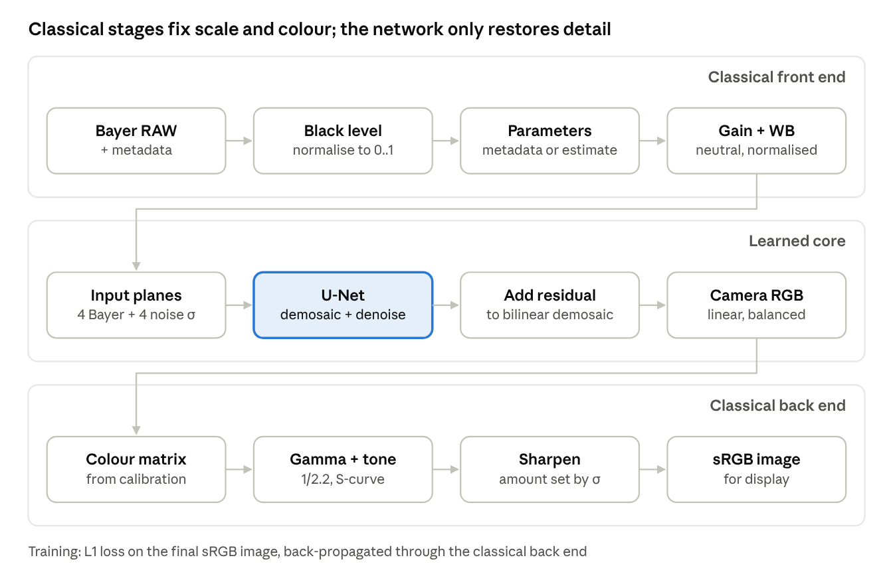
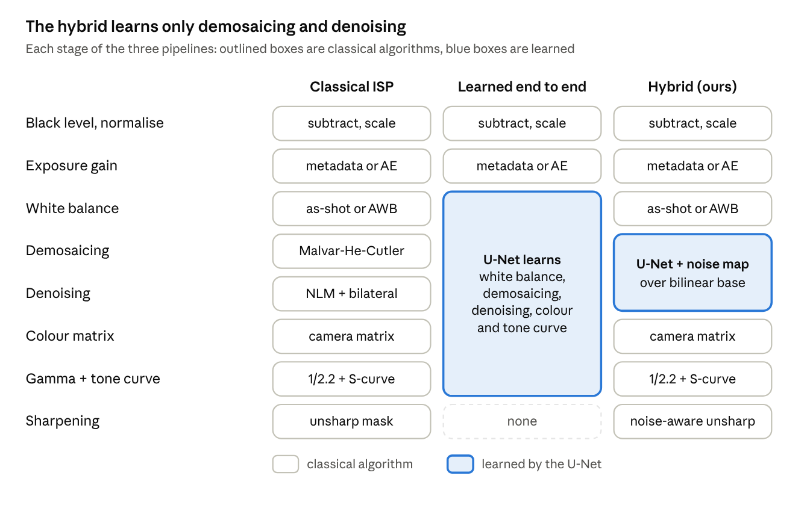

# Design document: hybrid smartphone ISP

Team T67 (Kuck coders), problem P2 (Intelligent and Computationally Efficient Smartphone ISP).

## 1. Goal

Turn degraded Bayer RAW into an sRGB photo with accurate colour, low noise and sharp detail. Inputs can be
under-exposed up to 32 times, carry a colour cast from the light source, and arrive with or without metadata
(white balance, noise profile, exposure). Inference has to run on a CPU without a GPU, and the deployable model
has to be small enough to ship inside a phone app.

## 2. Architecture

The repository holds three complete pipelines. They share the RAW loader, the metadata handling and the
evaluation code, and differ in which stages are learned:

| Module | Responsibility |
|---|---|
| `raw_sim.py` | sensor model (unprocessing, noise, 10-bit quantisation, colour matrix) and the differentiable colour and tone ops |
| `classical_isp.py` | classical stages, AWB, blind noise estimation, the classical baseline |
| `model.py` | the U-Net |
| `hybrid_isp.py` | hybrid and end-to-end pipelines, INT8 quantisation, real RAW loader, command-line tool |
| `train.py` | training of the core, end-to-end fine-tuning, distillation |
| `evaluate.py`, `benchmark.py`, `make_eval.py`, `report_figures.py` | quality metrics, efficiency, the submission file, figures |
| `app.py` | Streamlit application |

Every pipeline has the same interface: an RGGB Bayer mosaic (H x W) and a metadata dict in, an sRGB image
(H x W x 3, floats in [0, 1]) out. The dict holds black and white level, as-shot white balance, exposure gain,
noise profile (shot, read), the camera colour matrix and the illuminant range the sensor is calibrated for.
Any entry that is missing gets estimated from the image.

## 3. Design decisions

### 3.1 Which stages are learned

We learn only demosaicing and denoising. The alternatives were a fully learned ISP in the style of PyNET, or a
purely classical one.

Black level, gain, white balance, the colour matrix, gamma and the tone curve have exact formulas and per-sensor
calibration data. A network that learns them needs training data for every sensor and illuminant, and it fails
outside that range: under an unseen illuminant our end-to-end model scores 18.84 dB against 30.53 dB for the
hybrid. Demosaicing and denoising are ill-posed and depend on local image content, which is where a learned
model does better than hand-made filters. Because colour stays classical, the same network also processes a
real Pixel 4a DNG using the colour matrix stored in the file.

### 3.2 Network input and output

The RGGB mosaic is split into four half-resolution planes, which keeps each colour separate and cuts the
pixel count by four. Four more channels carry the noise standard deviation of each plane (the FFDNet idea), so
one network covers every noise level. The network outputs 12 channels at half resolution, rearranged by pixel
shuffle into full-resolution RGB, and predicts them as a residual over bilinear demosaicing. The residual
makes training converge much faster than predicting the image from scratch.

### 3.3 Loss through the classical back end

The loss is L1 on the final sRGB image, after the differentiable colour matrix, gamma and tone curve in
`raw_sim.py`. Errors are weighted as they appear in the displayed image, not in linear sensor values, and the
network is trained for the exact rendering the back end will apply.

### 3.4 Global context

A global-average-pooling branch at the bottleneck feeds whole-frame statistics back to every pixel. The
end-to-end model needs this for white balance and brightness, which depend on the whole scene. It costs 0.04M
parameters at width 24.

### 3.5 Training data

Public paired RAW datasets (ZRR, SIDD) are tens of GB, so we synthesise RAW from DIV2K with the unprocessing
model of Brooks et al. (CVPR 2019): inverse tone curve, inverse gamma, sRGB to camera matrix, inverse white
balance, RGGB mosaic, under-exposure, shot and read noise, 10-bit quantisation with a black level. Every step
is invertible, so the original image is the exact ground truth. Each 128 x 128 crop gets a random illuminant
(R gain 1.6 to 2.6, B gain 1.3 to 2.1), exposure gain (1 to 32) and noise level (shot noise 1e-4 to 1e-3, read
noise from the log-linear fit of Brooks et al.). Pixels near white keep their brightness through the inverse
white balance, so clipped highlights behave as on a real sensor.

### 3.6 Adaptive mechanism

| Quantity | From metadata | Fallback when missing | Used by |
|---|---|---|---|
| Noise profile (shot, read) | sensor calibration, as in the DNG NoiseProfile tag | blind estimator (below) | noise map for the network; denoise and sharpen strength in the classical stages |
| Exposure gain | capture settings | auto exposure: mean green to 18% grey | brightness normalisation; scales the noise map |
| White balance | as-shot gains | grey world (p = 1) clamped to the calibrated illuminant range | white balance stage |

The blind noise estimator high-pass filters each Bayer plane with the Immerkaer kernel, splits it into 8 x 8
blocks and bins them by brightness. In each bin the flattest 5% of blocks give the noise variance, with a 1.77
bias correction calibrated on flat test charts. A non-negative least-squares fit of var = shot * x + read gives
the profile. On the 24 test images its median error is within 12% from indoor light down to x64 gain; in bright
daylight it over-estimates by about 1.5x because texture leaks into the high-pass.

For AWB we compared grey world and shades of grey (p = 1, 2, 4, 8), with and without clamping to the
calibrated range, on DIV2K images. Clamped grey world had the lowest error (mean log-gain error 0.155, against
0.280 for unclamped p = 4).

The classical baseline sets its filters from the noise level sigma at mid-grey in the displayed image:
non-local means strength 0.6 sigma, bilateral range 4 sigma, sharpening amount 0.3 / (1 + 30 sigma). The two
constants were tuned on DIV2K, not on the test set.

### 3.7 Optimisation for mobile

Knowledge distillation trains a width-16 student (0.50M parameters) for 12k steps with loss
0.5 L1(ground truth) + 0.5 L1(teacher). Post-training static quantisation (PyTorch FX, oneDNN backend,
64 calibration crops from the training set) then converts it to INT8. The first convolution and the output
head stay in FP32: the first sees the raw input range and the head produces small residuals, where 8-bit steps
would show. The result is exported as TorchScript (`checkpoints/lite_int8.pt`).

We did not use unstructured pruning, which shrinks nothing at inference without sparse kernels, or FP16, which
the target laptop CPU has no native arithmetic for.

### 3.8 Deployment

The Streamlit application (`app.py`) runs on Streamlit Community Cloud with CPU-only PyTorch 2.13, the version
the models were trained, quantised and tested with. It compares the four pipelines on simulated captures with
adjustable light, noise and illuminant, or on an uploaded RAW/DNG file, and reports the metrics live. The
command-line tool (`hybrid_isp.py`) converts a RAW file to PNG.

## 4. Training setup

Free Colab T4 GPU (`colab/hybrid_isp_colab.ipynb`), batch 32, Adam at 3e-4 with cosine decay to 3e-6, gradient
clipping at 1.0, five DIV2K images held out for validation.

| Model | Steps | Time on T4 | Validation PSNR |
|---|---:|---:|---:|
| Hybrid core (width 24) | 15,000 | 8.2 min | 30.46 dB |
| End-to-end, fine-tuned from the core | 8,000 | 4.2 min | 26.68 dB |
| Hybrid-Lite (width 16), distilled | 12,000 | 6.6 min | 29.50 dB |

## 5. Evaluation method

Kodak24 is never used for training. Each image is converted to RAW under seven scenarios: five light levels
from x1 to x64 digital gain (x64 is outside the training range), an illuminant outside the training range, and
a capture with no white balance or noise metadata. Quality metrics are PSNR, SSIM, CIEDE2000 colour error and
LPIPS (AlexNet). Efficiency is measured on a 1024 x 1024 frame on an Intel i5-10210U (4 threads): parameters,
serialized model size, median latency after 2 warm-up runs (10 timed runs per model, 5 per full pipeline), and
the total size of the feature maps per frame.

Results are in [`eval_P2_T67.md`](../eval_P2_T67.md), the ablation study and failure cases in
[`ABLATION_AND_FAILURES.md`](ABLATION_AND_FAILURES.md).

## 6. Limitations

- Training and test RAW are synthesised, so fixed-pattern noise, lens shading and optical blur are missing.
  Fine-tuning the core on a real paired dataset such as ZRR is the next step.
- Gain above x32 is outside the training range.
- Without metadata, white balance relies on grey world.
- The real-RAW loader ignores the DNG lens-shading map, so corners of real photos stay slightly dark.
